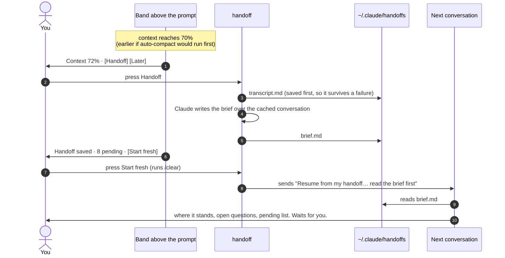

<div align="center">



<br>

**Your context is filling up. Press one button, and the next session picks up exactly where you left off.**

[](https://github.com/anthropics/claude-code/tree/main/mods)
[](handoff/.claude-plugin/plugin.json)
[](#verify-it-yourself)
[](LICENSE)

[Install](#install) · [How it works](#how-it-works) · [What a brief holds](#what-a-brief-holds) · [What it touches](#what-it-touches) · [FAQ](#faq)

</div>

---

## The problem

Long Claude Code sessions run out of context. The usual workaround goes like this: `/export` the conversation, open a new session, paste a long *"I was working on this in another session, continue from where I left off, answer every question we discussed, check what's pending…"* prompt, and hope the new session reads enough of the export to get going.

**handoff** turns that whole routine into one button.

<table>
<tr>
<th width="50%">Before</th>
<th width="50%">With handoff</th>
</tr>
<tr>
<td>

1. Notice the context is nearly full
2. `/export` to a file
3. Open a new session
4. Write the "continue from where I left off" prompt
5. Paste the export path
6. Wait while it reads a 300 KB transcript

</td>
<td>

1. Press **Handoff** when the band appears
2. Press **Start fresh**

That's it. The new conversation reads a focused brief, tells you where things stand, and waits for you.

</td>
</tr>
</table>

## Install

At the prompt of a terminal session:

```text
/plugin install handoff --marketplace aashish-g03/claude-mods
```

Answer `y` to add the marketplace, then pick the **user** scope so it runs in every project.

<details>
<summary>From a shell, or in the desktop app</summary>

<br>

From a shell:

```bash
claude plugin install handoff --marketplace aashish-g03/claude-mods
```

In the desktop app, where `/plugin` does not run: click **+** next to the prompt box, then **Plugins**, **Add marketplace** with `aashish-g03/claude-mods`, then **Add plugin**.

To update later: `claude plugin update handoff`, then `/reload-plugins`.

</details>

> [!NOTE]
> Mods are early access. They run with the same permissions as Claude Code itself and are **not sandboxed**, so read the code before installing any mod. This one is a single file, [`handoff/hooks/register.tsx`](handoff/hooks/register.tsx), about 300 lines.

## How it works



The band walks through each state:

| You see | What it means |
|---|---|
| `Context 72%` **`Handoff`** `Later` | Context passed the threshold. **Later** hides it until the context grows another 5 points. |
| `Writing handoff…` | The transcript is saved; Claude is writing the brief. |
| `Handoff saved · 8 pending` **`Start fresh`** `Dismiss` | Both files are on disk. **Start fresh** runs `/clear`. |
| `Resuming from handoff…` **`Skip`** | The cleared conversation resumes in a few seconds. **Skip** starts clean instead. |
| `Resumed from handoff · 8 pending` | The resume prompt was sent and Claude is reading the brief. |
| `Older handoff` **`Load`** `Skip` | The saved handoff is more than two days old, so it waits for you to choose. |

## What a brief holds

The brief is written by Claude over the conversation it is leaving, so it knows things a transcript dump doesn't make obvious: what was decided, what was rejected, and what you corrected along the way.

<details>
<summary><b>The sections of every brief</b></summary>

<br>

| Section | What goes in it |
|---|---|
| **Task in progress** | What you're working on, why, how far it got, and the very next step |
| **Questions raised and their status** | *Every* question from the conversation, each answered or marked OPEN with what's needed |
| **Pending** | A `- [ ]` checklist, most important first, including promised-but-not-done and unrun verifications |
| **Decisions** | Each decision and its reason, including approaches tried and rejected |
| **Files and state** | Files changed (absolute paths), branches, commits, running processes, uncommitted work |
| **Gotchas** | What went wrong or surprised you, and your stated corrections and preferences |
| **Skills, memories and tools** | What the next session should load or reuse |

The full transcript sits next to the brief, with tool output included (very long output is cut and the cut is marked). The new session opens it only when the brief is missing a detail.

</details>

## Commands

| Command | Does |
|---|---|
| `/handoff` | The same as the **Handoff** button: saves the transcript and the brief |
| `/handoff-skip` | Doesn't load the saved handoff in this folder. The files stay on disk. |

## What it touches

In the spirit of [secrets-veil](https://claudecodemods.dev/mods/secrets-veil): what this mod reaches, and what it deliberately doesn't. For the complete list of every call it makes, run `claude plugin validate handoff`.

| It does | Through |
|---|---|
| Reads the current conversation | `$.session.messages` |
| Asks Claude for the brief, over the cached conversation, billed to your account like any turn | `$.model.fork` |
| Writes two files under `~/.claude/handoffs/<project>/<timestamp>/` | `$.fs.write` |
| Remembers, per project folder, which handoff is waiting | `$.store` |
| Sends the resume prompt and runs `/clear` when you press **Start fresh** | `$.prompt.submit`, `$.command.run` |
| Reads `HOME` to find `~/.claude` | `$.env.get` |

**It does not** make network requests of its own, start processes, read files in your project, write anywhere inside your repos, or send anything anywhere except to Claude as part of your own session.

Transcripts can hold secrets and personal data from your session, which is why they're written to `~/.claude/handoffs/`, outside every repository, and never committed.

## FAQ

<details>
<summary><b>Why 70%? What about auto-compact?</b></summary>

<br>

At 70% there's still room for Claude to write a good brief. If auto-compact is on and would run earlier (on some setups the compaction window is smaller than the model's window), the button appears 5 points before compaction instead, so you never lose the full conversation before you can hand it off.

</details>

<details>
<summary><b>What does a handoff cost?</b></summary>

<br>

One extra model call. The brief is written over the conversation that's already in the prompt cache, so most of its input is served from cache.

</details>

<details>
<summary><b>Does it work on my other machines?</b></summary>

<br>

Install it on each machine with the line above. Handoffs themselves are saved per machine (`~/.claude/handoffs`), so a handoff saved on one machine resumes on that machine.

</details>

<details>
<summary><b>Why does it send a prompt instead of quietly loading the brief?</b></summary>

<br>

Some organizations run a policy plugin that passes prompt-shaping events on without calling personal mods, and a hidden note added at the start of a turn arrives after your first message. A real prompt that tells Claude to read the brief file works everywhere and starts the conversation for you, so you don't have to type anything.

</details>

<details>
<summary><b>What if something fails?</b></summary>

<br>

The transcript is always written first. If the brief fails, the band says so and offers **Retry**. If the resume prompt is refused, the band shows the brief's path so you can point Claude at it yourself.

</details>

## Verify it yourself

```bash
git clone https://github.com/aashish-g03/claude-mods && cd claude-mods
claude plugin validate handoff
claude plugin test handoff
```

The tests cover the ways it has actually failed or could fail: a compaction window smaller than the model's, a brief that fails, a write that throws, resuming only once after `/clear`, **Skip**, stale handoffs, and a refused resume prompt.

Tested on Claude Code 2.1.316 in a macOS terminal.

## License

[MIT](LICENSE) © aashish-g03

## Articles

[`articles/`](articles) holds posts about these mods, written as Markdown with dev.to front matter. They're published from a local machine with a personal Claude Code skill, not from this repo. Each article's dev.to id is kept in `articles/.devto.json` so republishing updates it in place.
