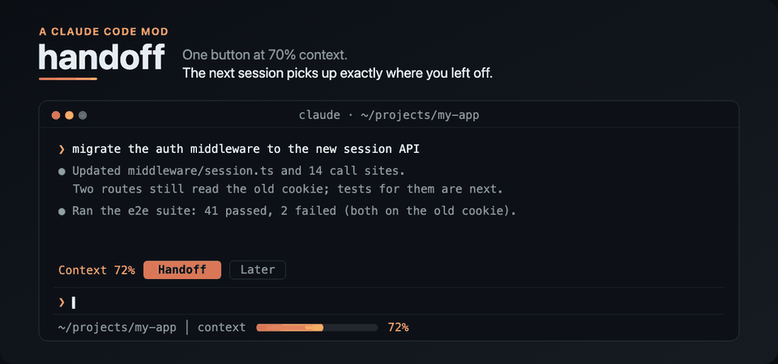

I have a ritual. Every time a Claude Code conversation reaches 75–80% of its context, I run `/export`, open a new session, and paste something like this:

> I was working on this project in another session but I'm moving to a new one. Continue from where I left off. Answer every question we discussed in the last session. Check skills and other things so we can start. Tell me what's still pending.

Then I paste the path to a 300 KB export and wait while the new session reads it, hoping it picks up the parts that matter.

It works, mostly. It's also the same five steps every single time, so I turned it into one button.



## What it does

**handoff** is a [Claude Code mod](https://github.com/anthropics/claude-code/tree/main/mods). When the context passes 70%, a band appears above the prompt:

```
Context 72%  [ Handoff ]  [ Later ]
```

Press **Handoff** and it:

1. Saves the full transcript, tool output included, to `~/.claude/handoffs/<project>/<timestamp>/transcript.md`.
2. Asks Claude to write a **brief** over the conversation it's leaving.
3. Shows `Handoff saved · 8 pending  [ Start fresh ]`.

Press **Start fresh** (or type `/clear`). A few seconds later the new conversation starts by itself with a prompt telling Claude to read the brief first, load the skills and memories it lists, summarise where things stand, and wait for you.

The brief is the part I care about. A raw transcript tells the next session *what was said*. The brief tells it what matters:

- **Task in progress**: how far it got and the very next step
- **Every question raised**, each one answered or marked OPEN
- **Pending**: a `- [ ]` checklist, most important first
- **Decisions**, including approaches tried and rejected
- **Files and state**: paths, branches, uncommitted work
- **Gotchas**: what went wrong, and the corrections I made along the way
- **Skills and memories** to load

On the run that worked end to end, the transcript was 212 KB and the brief was 16 KB, about 4,000 tokens. The new session read the brief, listed the open questions and the 7 pending items correctly, and waited for me.

## What a mod is

Mods are an early-access way to change Claude Code itself. A mod is a TypeScript module that registers hooks on engine events:

```ts
export const register: Register = on => {
  on('session.measure', async ($, e, next) => {
    // e.context.percent is the context fill after each turn
    return next(e)
  })

  on('ui.render', { component: 'AbovePrompt' }, async ($, e, next) => {
    const { Box, Button, Text } = $.ui.resolve(e)
    // draw the band, or call next(e) to draw nothing
  })
}
```

`$` is the engine: `$.session`, `$.model`, `$.fs`, `$.store`, `$.ui` and so on. `next(e)` passes the event to whatever comes after you. That's enough to build a band with buttons, a slash command, and a background timer.

## Four things that broke along the way

The first version worked in its tests and failed in real use in four different ways. These were the most useful parts of building it.

### 1. The button would never have appeared

I worked out the threshold from the auto-compact setting, so the button would show before compaction ran. I divided the compaction threshold by the *compaction window*. But the fill percentage Claude Code reports is over the *model's* window, and on some setups those differ. On a 1M-token model with a 200k compaction window, compaction fires at 16% of the model's window, while my maths put the button at 70%. The button would never have shown up.

The fix was one denominator. The test for it now uses exactly that setup.

### 2. A policy plugin skipped my hook

My first design put the brief into the next conversation's system prompt with a `prompt.compose` hook. The first live load printed this:

```
handoff: its prompt.compose hook was skipped. "cc-plugin-sec-default" runs first and sent the event on past it.
```

A security plugin loaded ahead of mine sends prompt-shaping events past personal mods. Fair enough, and yours may well do the same, so a mod shouldn't depend on those events.

### 3. The brief arrived 45 ms too late

So I switched to adding the brief as a hidden message at the start of the turn. The band said **Resumed from handoff**. Then I asked "what's pending?" and Claude answered about a completely different branch.

The transcript showed why: the hidden message was stored **45 ms after** my first prompt, after the request had already gone out. And because the brief only loaded on my first message, I still had to type something to get going.

### 4. The fix: just send a real prompt

The version that works is the simplest. After `/clear`, the mod sends a normal prompt, as if I'd typed it: *"Resume from my handoff… Read the brief at `<path>` first."* Claude reads the brief file itself, which doesn't depend on timing. It doesn't need any special access either. In the session log, the prompt arrived 0.6 s after `/clear`, with nothing typed in between.

There was one more catch. I had set that delay to 500 ms, so the **Skip** button on the "Resuming…" band was impossible to press. It's 4 seconds now. The prompt waits until the session is idle anyway, so the longer delay never interrupts anything.

## Tests that catch real bugs

Halfway through I read [Ray Fernando's post](https://x.com/RayFernando1337/status/2103279689615958062) about deleting 60,984 lines of "test slop". The idea: unit tests written after the code restate the code, always pass, and catch nothing.

I had 13 tests. Two of them, "the button appears at 72%" and "/handoff writes two files", only restated the implementation, so I deleted them. The 9 that remain each pin a way the mod has actually failed or could fail: the compaction-window maths, a brief that fails, a file write that throws, resuming exactly once after `/clear`, Skip, stale handoffs, and a refused resume prompt. The real checks were the live runs.

## What it touches

Mods run with Claude Code's own permissions and aren't sandboxed, so here's everything this one reaches:

- Reads the current conversation (`$.session.messages`)
- Asks Claude for the brief over the cached conversation (`$.model.fork`), billed like any turn
- Writes two files under `~/.claude/handoffs/`, never inside your repos
- Remembers which handoff is waiting, per folder (`$.store`)
- Sends the resume prompt and runs `/clear` when you press the button

It makes no network calls of its own and starts no processes. It's one file, about 300 lines. [Read it](https://github.com/aashish-g03/claude-mods/blob/main/handoff/hooks/register.tsx) before you install it.

## Try it

At a Claude Code prompt:

```
/plugin install handoff --marketplace aashish-g03/claude-mods
```

Pick the **user** scope so it runs in every project. The code, tests and a full README are at [github.com/aashish-g03/claude-mods](https://github.com/aashish-g03/claude-mods).

If you have your own ritual for running out of context, I'd like to hear it in the comments.
