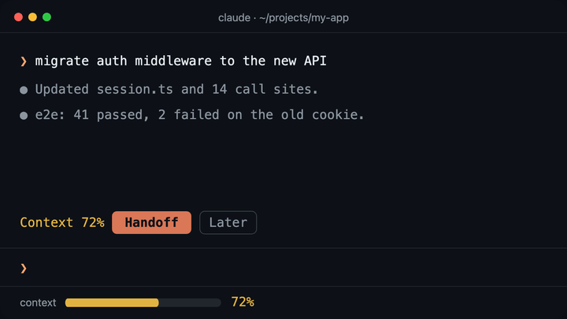

> **TL;DR:** **handoff** is a Claude Code mod. When a conversation passes **70%** of its context, a **Handoff** button appears above the prompt. One press saves the full transcript (**212 KB** on my last run) and has Claude write a **16 KB brief**: the task, every open question, a pending checklist, decisions and gotchas. Press **Start fresh**, and **0.6 s** after `/clear` the new conversation resumes from the brief by itself, with nothing typed. It does **not** carry handoffs between machines, and I've only tested it in a macOS terminal.
>
> [Code](https://github.com/aashish-g03/claude-mods) | [Install](#try-it) | Built on Claude Code mods (early access)



---

## "Continue from where I left off"

Every time a Claude Code conversation hit 75–80% of its context, I did the same five things:


The prompt I pasted was always some version of:

> I was working on this project in another session but I'm moving to a new one. Continue from where I left off. Answer every question we discussed. Check skills and other things so we can start. Tell me what's still pending.

It mostly worked. But a raw export tells the next session *what was said*, not *what mattered*, so it re-read everything and guessed. And it was the same five steps, every time.

## What I built

A band that sits above the prompt and walks through the handoff:

| You see | What it means |
|---|---|
| `Context 72%` **`Handoff`** `Later` | Past the threshold. **Later** waits another 5 points. |
| `Handoff saved · 8 pending` **`Start fresh`** | Both files are on disk. **Start fresh** runs `/clear`. |
| `Resuming from handoff…` **`Skip`** | The cleared conversation resumes in a few seconds. |
| `Resumed from handoff · 8 pending` | Claude is reading the brief. |

The brief is the point. Claude writes it over the conversation it's leaving, so it knows what was decided, what was rejected and what I corrected along the way:


On the run that worked end to end, the new session read the brief, listed the open questions and all 7 pending items correctly, and waited for me before touching anything. The full transcript stays on disk next to the brief, for the rare detail the brief leaves out.

## What a mod is

Mods are an early-access way to change Claude Code itself. A mod is a TypeScript module that hooks engine events:

```ts
export const register: Register = on => {
  // After every turn: how full is the context?
  on('session.measure', async ($, e, next) => {
    // e.context.percent → show the band at 70%
    return next(e)
  })

  // Draw the band above the prompt, or nothing.
  on('ui.render', { component: 'AbovePrompt' }, async ($, e, next) => {
    const { Box, Button, Text } = $.ui.resolve(e)
    // …
  })
}
```

`$` is the engine (`$.session`, `$.model`, `$.fs`, `$.store`, `$.ui`…), and `next(e)` hands the event to whatever comes after you. That's enough for a band with buttons, two slash commands and a timer.

## What didn't work

The first version passed its tests and then failed in real use four different ways. These were the most useful part of building it.

### 1. The button would never have appeared

The button is meant to come up before auto-compact runs. I worked out the auto-compact point over the *compaction* window, but the fill Claude Code reports is over the *model's* window. When those differ, it breaks:


The fix was one denominator. The test for it uses exactly that setup.

### 2. A security plugin skipped my hook

My first design slipped the brief into the next conversation's system prompt with a `prompt.compose` hook. The first live load printed:

```
handoff: its prompt.compose hook was skipped. "cc-plugin-sec-default" runs first and sent the event on past it.
```

A security plugin loaded ahead of mine sends prompt-shaping events past personal mods. Fair enough, and yours may well do the same, so don't build on those events.

### 3. The brief arrived 45 ms too late

Next I added the brief as a hidden note at the start of the turn. The band said **Resumed**, so I asked "what's pending?", and Claude answered about a completely different branch. The session log showed why:


### 4. The fix was the simplest version

After `/clear`, the mod just sends a normal prompt, as if I'd typed it: *"Resume from my handoff… Read the brief at `<path>` first."* Claude reads the file itself, which doesn't depend on timing or need any special access.

One last catch: I'd set that delay to 500 ms, which made the **Skip** button impossible to press. It's 4 seconds now. The prompt waits until the session is idle anyway, so it never interrupts you.

## Tests that catch real bugs

Halfway through I read [Ray Fernando's post](https://x.com/RayFernando1337/status/2103279689615958062) about deleting 60,984 lines of "test slop": unit tests written after the code restate the code and catch nothing. I had 13 tests and deleted the 2 that only restated the implementation.

The 9 left each pin a way the mod has actually failed or could fail:
- a compaction window smaller than the model's window
- a brief that fails, and a file write that throws
- resuming exactly once after `/clear`
- **Skip**, stale handoffs, and a refused resume prompt

The real checks were the live runs.

## What it touches

Mods run with Claude Code's own permissions and aren't sandboxed. This one:

- reads the current conversation and asks Claude for the brief (billed like any turn)
- writes two files under `~/.claude/handoffs/`, never inside your repos
- remembers, per folder, which handoff is waiting
- sends the resume prompt and runs `/clear` when you press the button

It makes no network calls of its own and starts no processes. It's [one file, about 300 lines](https://github.com/aashish-g03/claude-mods/blob/main/handoff/hooks/register.tsx), so read it before you install it.

## Try it

- **Install:** at a Claude Code prompt, run `/plugin install handoff --marketplace aashish-g03/claude-mods`, then pick the **user** scope so it runs in every project.
- **Use:** keep working until the band appears at 70%, press **Handoff**, then **Start fresh**. You can also type `/handoff`, and `/handoff-skip` starts clean.
- **Read the code:** [github.com/aashish-g03/claude-mods](https://github.com/aashish-g03/claude-mods), with the tests and a full README.

Next, I want to check that the new-window path resumes as reliably as `/clear` does, and to try a pending pane that lets you tick items off while you work.

If you have your own ritual for running out of context, I'd like to hear it in the comments.

## AI disclosure

I built this with Claude Code as a coding assistant, and Claude helped draft this post and make its diagrams. The design decisions, the bugs and the fixes described here are mine to explain and defend.
